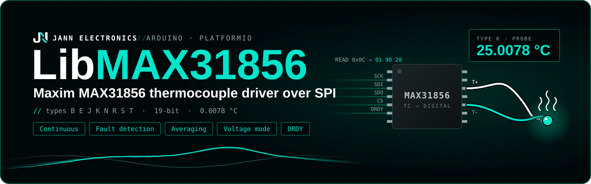

<p align="center">
  
</p>

# LibMAX31856

Arduino/ESP32 driver for the **MAX31856** thermocouple-to-digital converter, communicating over SPI.

## Features

- Supports all thermocouple types: **B, E, J, K, N, R, S, T** and direct voltage modes (×8, ×32)
- Three conversion modes: **OneShot** (blocking), **OneShotNoWait** (non-blocking), and **Continuous**
- 50 Hz / 60 Hz power-line noise filter and 1–16 sample averaging
- Configurable open-circuit detection, fault thresholds, fault mode (comparator / interrupt) and
  FAULT pin mask
- Cold-junction offset, or an external cold-junction sensor instead of the internal one
- Optional DRDY pin support
- Communication check in `begin()`
- Full fault register decoding with bitmask operators and `toString()` helpers
- Clean C++ namespace (`MAX31856`) — no global name pollution

## Hardware

| Signal | Description                         |
| ------ | ----------------------------------- |
| SCK    | SPI clock                           |
| MISO   | SPI data from sensor                |
| MOSI   | SPI data to sensor                  |
| CS     | Chip select (active low)            |
| DRDY   | Data ready (active low, optional)   |
| FAULT  | Fault output (open drain, optional) |

> The SPI bus must be initialized externally with `SPI.begin()` before calling `Driver::begin()`.

## Installation

Place the `src/` folder contents in your project's `lib/MAX31856/` directory, or install via PlatformIO's library manager.

## Quick Start

```cpp
#include <SPI.h>
#include "MAX31856.h"

// Adjust pins to match your hardware
constexpr int8_t PIN_SCK  = 18;
constexpr int8_t PIN_MISO = 19;
constexpr int8_t PIN_MOSI = 23;
constexpr int8_t PIN_CS   = 5;

MAX31856::Driver sensor(PIN_CS, SPI);

void setup() {
  Serial.begin(115200);
  SPI.begin(PIN_SCK, PIN_MISO, PIN_MOSI);

  // Settings made before begin() are applied by begin() in one go
  sensor.setType(MAX31856::Type::K);
  sensor.setConversionMode(MAX31856::ConversionMode::OneShot);

  if (!sensor.begin()) {
    Serial.println("MAX31856 not responding");
    while (true);
  }
}

void loop() {
  MAX31856::Measurement m;
  if (sensor.read(m)) {
    Serial.printf("Probe: %.3f °C  |  Cold Junction: %.3f °C\n", m.temperature, m.cold_junction);

    if (MAX31856::any(m.fault)) {
      char buf[64];
      MAX31856::toString(m.fault, buf, sizeof(buf));
      Serial.printf("Faults: %s\n", buf);
    }
  }

  delay(1000);
}
```

## Conversion modes

| Mode            | Behaviour of the read functions                                                           |
| --------------- | ----------------------------------------------------------------------------------------- |
| `OneShot`       | Triggers a conversion and waits for it (~200 ms with default settings). `NAN` on timeout. |
| `OneShotNoWait` | Returns the previous result immediately and triggers the next conversion.                 |
| `Continuous`    | The chip converts every ~100 ms; returns the latest result immediately.                   |

In the non-blocking modes, reads return `NAN` (or `read()` returns `false`) until the first
conversion after `begin()` or after a configuration change has finished.

In `OneShot` mode **each** read function performs its own conversion. Use `read()` to get the
probe temperature, cold-junction temperature and faults from a single conversion.

## Configuration

Setters can be called before `begin()`; the values are stored and `begin()` applies them. After
`begin()`, every setter is applied immediately. Settings in the CR0/CR1 registers stop the
conversions before changing them (as the datasheet requires for the noise filter and averaging),
which can block for up to one conversion time. Calling `begin()` again re-applies the whole
configuration, e.g. after the sensor lost power.

| Setting                  | Default       |
| ------------------------ | ------------- |
| Type                     | K             |
| Conversion mode          | OneShot       |
| Noise filter             | 50 Hz         |
| Averaging                | 1 sample      |
| Open-circuit detection   | Rs < 5 kΩ     |
| Fault mode               | Comparator    |
| FAULT pin                | All faults    |
| Probe fault thresholds   | Full range    |
| Cold-junction thresholds | −64 to 127 °C |
| Cold-junction offset     | 0 °C          |
| Cold-junction sensor     | Internal      |

## API Reference

### `Driver`

| Method                                                                        | Description                                                                                          |
| ----------------------------------------------------------------------------- | ---------------------------------------------------------------------------------------------------- |
| `Driver(cs_pin, spi, spi_freq_hz)`                                            | Constructor. SPI bus must be started externally. `spi_freq_hz` defaults to 1 MHz (clamped to 5 MHz). |
| `begin()`                                                                     | Checks communication and applies the configuration. `false` if the chip does not respond.            |
| `setType(Type)` / `getType()`                                                 | Thermocouple type or voltage mode.                                                                   |
| `setConversionMode(ConversionMode)` / `getConversionMode()`                   | OneShot, OneShotNoWait or Continuous.                                                                |
| `setNoiseFilter(NoiseFilter)` / `getNoiseFilter()`                            | 50 Hz or 60 Hz noise rejection.                                                                      |
| `setAveraging(Averaging)` / `getAveraging()`                                  | 1, 2, 4, 8 or 16 samples per conversion.                                                             |
| `setOpenCircuitDetection(OpenCircuitDetection)` / `getOpenCircuitDetection()` | Open-circuit test matching the lead resistance.                                                      |
| `setProbeFaultThresholds(low, high)`                                          | Thermocouple fault limits (°C). `false` if NAN or `low > high`.                                      |
| `setColdJunctionFaultThresholds(low, high)`                                   | Cold-junction fault limits (°C, −128 to 127). `false` if `low > high`.                               |
| `setFaultMode(FaultMode)` / `getFaultMode()`                                  | Comparator (faults follow the condition) or Interrupt (faults latch).                                |
| `setFaultOutput(Fault)` / `getFaultOutput()`                                  | Faults that assert the FAULT pin.                                                                    |
| `clearFaults()`                                                               | Clears latched faults in Interrupt mode.                                                             |
| `setColdJunctionOffset(°C)` / `getColdJunctionOffset()`                       | Offset added to the cold-junction temperature (−8 to +7.9375 °C).                                    |
| `setColdJunctionSensorEnabled(bool)` / `isColdJunctionSensorEnabled()`        | Internal cold-junction sensor on/off.                                                                |
| `writeColdJunctionTemperature(°C)`                                            | Supplies the cold-junction temperature when the internal sensor is off.                              |
| `setDataReadyPin(pin)`                                                        | Optional DRDY pin (−1 to disable).                                                                   |
| `read(Measurement&)`                                                          | Temperature / voltage, cold junction and faults from one conversion.                                 |
| `readProbeTemperature()`                                                      | Thermocouple tip temperature in °C (`NAN` in voltage modes or without result).                       |
| `readVoltage()`                                                               | Thermocouple input voltage in V (`NAN` in thermocouple modes or without result).                     |
| `readColdJunctionTemperature()`                                               | Cold-junction (PCB) temperature in °C.                                                               |
| `readFault()`                                                                 | `Fault` bitmask from the status register (no conversion triggered).                                  |
| `triggerOneShot()`                                                            | Manually starts a one-shot conversion (no-op if one is running).                                     |
| `conversionComplete()`                                                        | One-shot modes: no conversion running. Continuous: new data (DRDY) or first conversion done.         |

### `Measurement`

```cpp
struct Measurement {
  float temperature;   // °C (NAN in voltage modes)
  float voltage;       // V (NAN in thermocouple modes)
  float cold_junction; // °C
  Fault fault;
};
```

### `Fault` helpers

```cpp
MAX31856::any(f)              // true if any fault bit is set
MAX31856::has(f, Fault::Open) // true if a specific bit is set
MAX31856::toString(f, buf, size) // writes active fault names to buffer
```

With an `Open` or `OverUnder` fault the temperature reading is not valid. While `OverUnder` is
present the chip suspends conversions, so `OneShot` reads time out and return `NAN`.

### Voltage mode

`readVoltage()` uses the datasheet transfer function `Code = gain × 1.6 × 2¹⁷ × VIN`, where `Code`
is the 19-bit signed value of the thermocouple registers.

## License

Released under the [MIT License](LICENSE).
